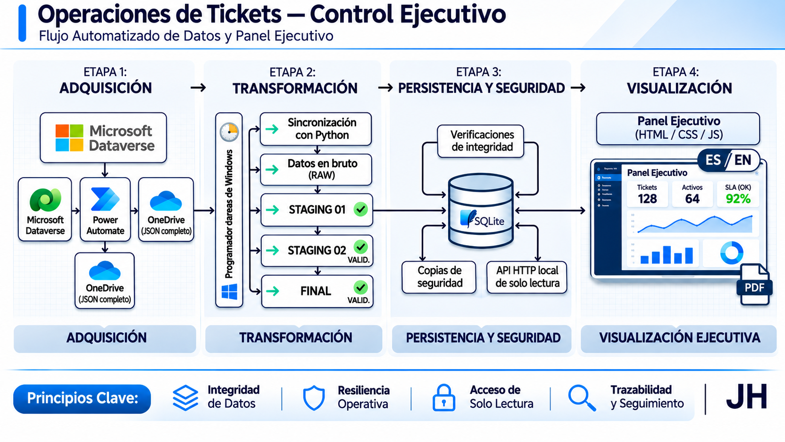

# Ticket Operations — Executive Control

[English](README.md) | [Español](README.es.md)

**Flujo de datos automatizado y panel ejecutivo**

Un caso de estudio técnico de **Juan Herbozo**

*Sistemas empresariales · Integración · IA*

## Arquitectura de referencia

*Diagrama de arquitectura ilustrativo. Las métricas y los elementos visuales del panel son representativos y no contienen datos operativos reales.*

## Descripción general

Ticket Operations — Executive Control es una solución de análisis
alojada localmente, diseñada para transformar registros operativos
de servicios en información estructurada para su seguimiento y
la toma de decisiones.

La solución integra Microsoft Dataverse, Power Automate, OneDrive,
Python, SQLite y un panel ejecutivo interactivo.

Su finalidad es reducir las actividades repetitivas de elaboración
de informes y mantener una visión coherente y auditable de las
incidencias, solicitudes, información de SLA y registros de tiempo.

## Arquitectura

| Componente | Tecnología | Propósito |
|---|---|---|
| Datos operativos | Microsoft Dataverse | Origen de incidencias, solicitudes, SLA y registros de tiempo |
| Adquisición de datos | Power Automate | Extracción programada de instantáneas JSON completas |
| Intercambio de archivos | OneDrive / JSON FULL | Entrega de instantáneas al procesamiento local |
| Sincronización | Python | Detección, verificación e incorporación de instantáneas |
| Carga de origen | RAW | Información inicial orientada al origen |
| Integración | STAGING 01 | Alineación e integración de datos |
| Procesamiento de negocio | STAGING 02 | Reglas de negocio y transformaciones |
| Resultado analítico | FINAL | Representación analítica validada |
| Persistencia | SQLite | Información analítica y controles de procesamiento |
| Acceso a datos | API local de solo lectura | Consulta controlada de información analítica |
| Presentación | HTML, CSS, JavaScript | Dashboard bilingüe, gráficos, filtros y exportación PDF |

La arquitectura separa la adquisición, transformación,
persistencia y visualización en componentes que pueden validarse
de forma independiente.

## Tecnologías utilizadas

| Componente | Tecnología |
|---|---|
| Datos operativos | Microsoft Dataverse |
| Extracción de datos | Power Automate |
| Intercambio de archivos | Microsoft OneDrive |
| Formato de instantánea | JSON FULL |
| Procesamiento de datos | Python |
| Persistencia | SQLite |
| Visualización | HTML, CSS, JavaScript |
| API local | Servidor HTTP de Python |
| Programación de tareas | Programador de tareas de Windows |
| Control de versiones | Git y GitHub |

## Capacidades principales

- Extracción automatizada de registros operativos.
- Ingesta de instantáneas completas con validación.
- Procesamiento estructurado mediante capas RAW, STAGING y FINAL.
- Publicación controlada de datos validados en SQLite.
- Registros de sincronización y copias de seguridad para recuperación.
- Métricas ejecutivas, filtros y análisis interactivos.
- Interfaz del panel disponible en español e inglés.
- Generación de informes PDF.
- Acceso local de solo lectura a la información analítica.
- Indicador visual del estado de sincronización.

## Enfoque de ingeniería

### Integridad de los datos

Las nuevas instantáneas se procesan y validan antes de publicarse
como el estado actual de la base de datos.

### Separación de responsabilidades

La adquisición de datos, transformación, sincronización y
presentación del panel funcionan como componentes independientes.

### Resiliencia operativa

La solución incorpora copias de seguridad de la base de datos,
comprobaciones de integridad, auditoría de sincronización y
mecanismos de protección frente al procesamiento duplicado.

### Visualización de solo lectura

El panel accede a SQLite mediante un servicio local limitado
a la interfaz de bucle local y no expone operaciones de
modificación de la base de datos.

### Trazabilidad

Las decisiones técnicas, los resultados de validación y los
desafíos de implementación se documentan como parte del
ciclo de vida del proyecto.

## Estado de validación

La implementación local se ha probado mediante:

- Importaciones sucesivas de instantáneas completas.
- Verificación de integridad de SQLite.
- Comprobaciones de consistencia de lotes de origen y checksums.
- Validación de los recuentos de registros en RAW, STAGING y FINAL.
- Ejecución local de tareas programadas.
- Verificación de la API de solo lectura y del panel.
- Pruebas funcionales de las visualizaciones y filtros del panel.

La programación recurrente de Power Automate está configurada.
La ejecución integral, programada y desatendida requiere una
confirmación operativa independiente.

## Alcance y confidencialidad

Este repositorio público documenta el enfoque de ingeniería y
la arquitectura de la solución.

No incluye bases de datos de producción, exportaciones JSON
operativas, credenciales corporativas, registros confidenciales
de servicios ni copias sin restricciones de lógica empresarial
interna.

Cualquier ejemplo de implementación o conjunto de datos
demostrativos que se incorpore en el futuro deberá revisarse
y anonimizarse antes de su publicación.

## Guías de implementación

### Documentación disponible

- [Arquitectura de referencia](docs/es/architecture.md)
- [Guía 01 — Preparación y requisitos previos](docs/es/guides/01-prerequisites.md)
- [Guía 02 — Adquisición de datos](docs/es/guides/02-data-acquisition.md)
- [Guía 03 — Procesamiento y sincronización con Python](docs/es/guides/03-python-processing.md)
- [Guía 04 — Persistencia en SQLite e integridad de datos](docs/es/guides/04-sqlite-persistence.md)
- [Guía 05 — Dashboard ejecutivo y API de solo lectura](docs/es/guides/05-executive-dashboard.md)

## Hoja de ruta de documentación

La documentación adicional abordará:

- Arquitectura y flujo de datos.
- Capas de procesamiento y sincronización.
- Diseño y capacidades del panel ejecutivo.
- Estrategia de validación.
- Desafíos técnicos y lecciones aprendidas.

## Autor

**Juan Herbozo**

Sistemas empresariales · Integración · IA

---

*Este repositorio presenta un caso de estudio técnico y no una
copia desplegable de un entorno operativo corporativo.*
