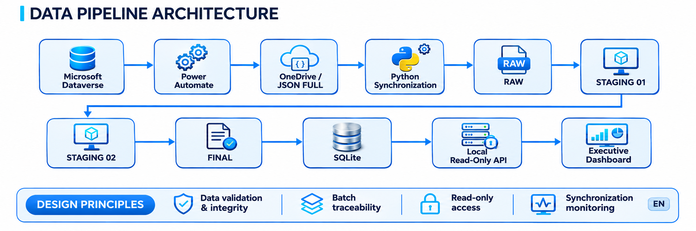
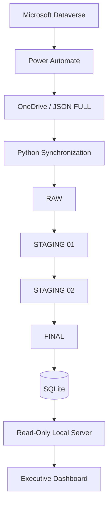

# Ticket Operations — Executive Control

[English](README.md) | [Español](README.es.md)

**Automated Data Pipeline & Executive Dashboard**

A technical case study by **Juan Herbozo**

*Business Systems · Integration · AI*

## Reference Architecture

*Illustrative architecture diagram. Dashboard metrics and visual elements are representative and do not contain actual operational data.*

## Overview

Ticket Operations — Executive Control is a locally hosted analytics
solution designed to transform operational service records into
structured information for monitoring and decision-making.

The solution integrates Microsoft Dataverse, Power Automate, OneDrive,
Python, SQLite, and an interactive executive dashboard.

Its purpose is to reduce repetitive reporting activities while
maintaining an auditable and consistent view of incidents, requests,
SLA information, and time entries.

## Architecture

The architecture separates acquisition, transformation, persistence,
and visualization into independently validated components.

## Technology Stack

| Component | Technology |
|---|---|
| Operational data | Microsoft Dataverse |
| Data extraction | Power Automate |
| File exchange | Microsoft OneDrive |
| Snapshot format | JSON FULL |
| Data processing | Python |
| Persistence | SQLite |
| Visualization | HTML, CSS, JavaScript |
| Local API | Python HTTP server |
| Scheduling | Windows Task Scheduler |
| Version control | Git and GitHub |

## Core Capabilities

- Automated extraction of operational records.
- Full-snapshot ingestion with validation.
- Structured RAW, STAGING, and FINAL processing layers.
- Controlled publication of validated SQLite data.
- Synchronization logs and recovery backups.
- Interactive executive metrics, filtering, and analysis.
- Bilingual dashboard interface.
- PDF reporting.
- Local read-only access to operational analytics.
- Visual synchronization status indicator.

## Engineering Approach

### Data integrity

New snapshots are processed and validated before being published
as the current database state.

### Separation of responsibilities

Data acquisition, transformation, synchronization, and dashboard
presentation operate as separate components.

### Operational resilience

The solution incorporates database backups, integrity checks,
synchronization auditing, and safeguards against duplicate processing.

### Read-only visualization

The dashboard accesses SQLite through a loopback-only local service
and does not expose database modification operations.

### Traceability

Technical decisions, validation results, and implementation
challenges are documented as part of the project lifecycle.

## Validation Status

The local implementation has been tested through:

- Successive full-snapshot imports.
- SQLite integrity verification.
- Source-batch and checksum consistency checks.
- Validation of RAW, STAGING, and FINAL record counts.
- Local scheduled-task execution.
- Read-only API and dashboard verification.
- Functional checks of dashboard visualizations and filters.

The recurring Power Automate schedule has been configured.
A scheduled, unattended end-to-end execution requires separate
operational confirmation.

## Scope and Confidentiality

This public repository documents the engineering approach and
solution architecture.

It does not include production databases, operational JSON exports,
corporate credentials, confidential service records, or unrestricted
copies of internal business logic.

Any future implementation examples or demonstration datasets
must be independently reviewed and sanitized before publication.

## Implementation guides

### Available documentation

- [Reference Architecture](docs/en/architecture.md)

## Documentation Roadmap

Additional documentation will cover:

- Architecture and data flow.
- Processing layers and synchronization.
- Dashboard design and capabilities.
- Validation strategy.
- Technical challenges and lessons learned.

## Author

**Juan Herbozo**

Business Systems · Integration · AI

---

*This repository presents a technical case study rather than a
deployable copy of a corporate operational environment.*
