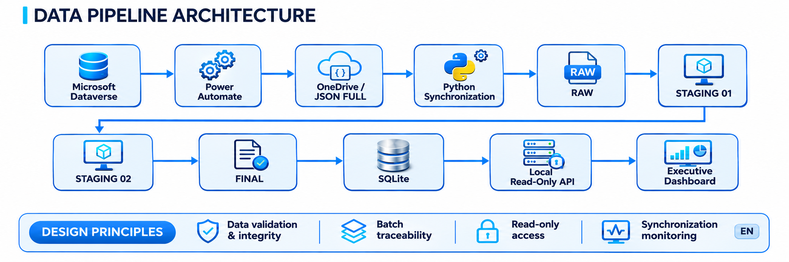
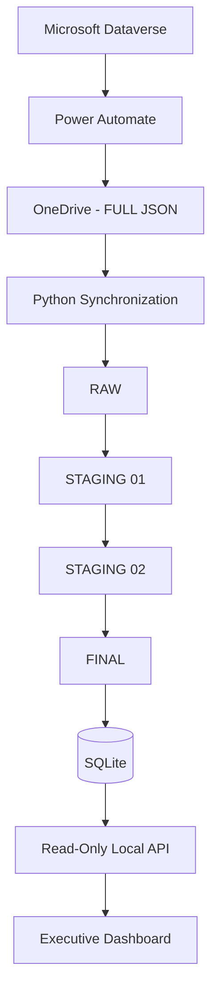

# Reference Architecture — Ticket Operations

[English](../en/architecture.md) | [Español](../es/architecture.md)

## Purpose

Ticket Operations — Executive Control is a locally hosted
analytics solution that consolidates operational service records
into validated, structured information for executive monitoring.

The architecture separates data acquisition, transformation,
persistence, and visualization.

## Architecture Diagram

*Illustrative architecture diagram. Dashboard metrics and
visual elements do not represent actual operational data.*

## End-to-End Data Flow

## Component Responsibilities

| Component | Responsibility |
|---|---|
| Microsoft Dataverse | Operational source for incidents, requests, SLA records and time entries |
| Power Automate | Scheduled extraction of full data snapshots |
| OneDrive | Controlled exchange of JSON snapshot files |
| Python | Synchronization, validation and staged processing |
| RAW | Preservation of source-oriented imported information |
| STAGING 01 | Integration and structural standardization |
| STAGING 02 | Business transformation and preparation |
| FINAL | Validated dataset for analytical consumption |
| SQLite | Local persistence of structured information |
| Local API | Read-only access to approved data |
| Executive Dashboard | Interactive metrics, filtering, bilingual views and PDF reporting |

## Snapshot Processing

The data pipeline follows a controlled sequence:

1. Power Automate extracts operational information from Dataverse.
2. Full JSON snapshots are delivered through OneDrive.
3. Python checks incoming data and synchronization state.
4. Information passes through RAW, STAGING 01, STAGING 02 and FINAL.
5. Validated data is made available through SQLite.
6. A loopback-only API supplies the executive dashboard.

## Data Integrity and Operational Controls

The implementation incorporates source-batch traceability,
checksum comparison, database integrity checks, synchronization
logging and recovery backups.

The synchronization process is separated from visualization.
The dashboard cannot initiate database modification operations.

## Automation

Power Automate and Windows Task Scheduler provide separate
automation responsibilities.

Power Automate handles source extraction, while the local
scheduled process checks for new snapshots and coordinates
their ingestion.

The recurring extraction schedule has been configured.
A fully unattended, scheduled end-to-end execution requires
separate operational confirmation.

## Security Boundary

The dashboard accesses analytical information through a
read-only HTTP service bound to the local loopback interface.

The public case study does not expose corporate credentials,
production data files, confidential records or unrestricted
copies of internal business logic.

## Validation Status

Local validation has covered successive full-snapshot imports,
SQLite integrity, source-batch consistency, processing-layer
counts, local task execution and dashboard functionality.

These results do not imply that every future scheduled
execution has already been verified.

## Scope and Limitations

The architecture describes the current Python and SQLite
pipeline. An earlier Excel/Power Query exploration is not
part of this current operational data flow.

This repository is documentation of an engineering case
study, not a deployable corporate production package.

## Related Documentation

[Project overview](../../README.md)