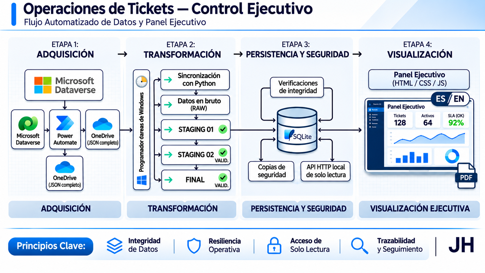
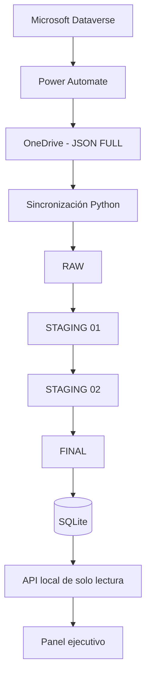

# Arquitectura de referencia — Ticket Operations

[English](../en/architecture.md) | [Español](../es/architecture.md)

## Objetivo

Ticket Operations — Executive Control es una solución de análisis
alojada localmente que consolida registros operativos de servicios
en información estructurada y validada para el seguimiento ejecutivo.

La arquitectura separa la adquisición de datos, transformación,
persistencia y visualización.

## Diagrama de arquitectura

*Diagrama de arquitectura ilustrativo. Las métricas y los
elementos visuales no representan datos operativos reales.*

## Flujo de datos de extremo a extremo

## Responsabilidades de los componentes

| Componente | Responsabilidad |
|---|---|
| Microsoft Dataverse | Origen operativo de incidencias, solicitudes, SLA y registros de tiempo |
| Power Automate | Extracción programada de instantáneas completas |
| OneDrive | Intercambio controlado de archivos JSON |
| Python | Sincronización, validación y procesamiento por capas |
| RAW | Conservación de la información importada desde el origen |
| STAGING 01 | Integración y estandarización estructural |
| STAGING 02 | Transformación de negocio y preparación |
| FINAL | Conjunto validado para consumo analítico |
| SQLite | Persistencia local de información estructurada |
| API local | Acceso de solo lectura a los datos aprobados |
| Panel ejecutivo | Métricas, filtros, vistas bilingües e informes PDF |

## Procesamiento de instantáneas

El flujo de datos sigue una secuencia controlada:

1. Power Automate extrae información operativa de Dataverse.
2. Las instantáneas JSON FULL se entregan mediante OneDrive.
3. Python comprueba los datos entrantes y el estado de sincronización.
4. La información atraviesa RAW, STAGING 01, STAGING 02 y FINAL.
5. Los datos validados quedan disponibles en SQLite.
6. Una API limitada a la interfaz local abastece el panel ejecutivo.

## Integridad de datos y controles operativos

La implementación incorpora trazabilidad de lotes de origen,
comparación de checksums, comprobaciones de integridad de
la base de datos, registros de sincronización y copias de
seguridad para recuperación.

La sincronización está separada de la visualización.
El panel no puede iniciar operaciones de modificación
de la base de datos.

## Automatización

Power Automate y el Programador de tareas de Windows cumplen
responsabilidades independientes.

Power Automate gestiona la extracción desde el origen.
El proceso local programado comprueba la llegada de nuevas
instantáneas y coordina su incorporación.

La programación recurrente de extracción está configurada.
La ejecución integral, programada y desatendida requiere
confirmación operativa independiente.

## Límite de seguridad

El panel accede a la información analítica mediante un
servicio HTTP de solo lectura vinculado a la interfaz
de bucle local.

El caso de estudio público no expone credenciales corporativas,
archivos de producción, registros confidenciales ni copias
sin restricciones de lógica empresarial interna.

## Estado de validación

La validación local ha incluido importaciones sucesivas de
instantáneas completas, integridad de SQLite, consistencia
de lotes, recuentos entre capas, ejecución local de tareas
y funcionamiento del panel ejecutivo.

Estos resultados no implican que todas las futuras ejecuciones
programadas hayan sido verificadas.

## Alcance y limitaciones

La arquitectura describe el flujo actual basado en Python
y SQLite. Una exploración anterior con Excel/Power Query
no forma parte de este flujo operativo actual.

Este repositorio documenta un caso de estudio de ingeniería,
no un paquete desplegable de un entorno corporativo de producción.

## Documentación relacionada

[Descripción general del proyecto](../../README.es.md)